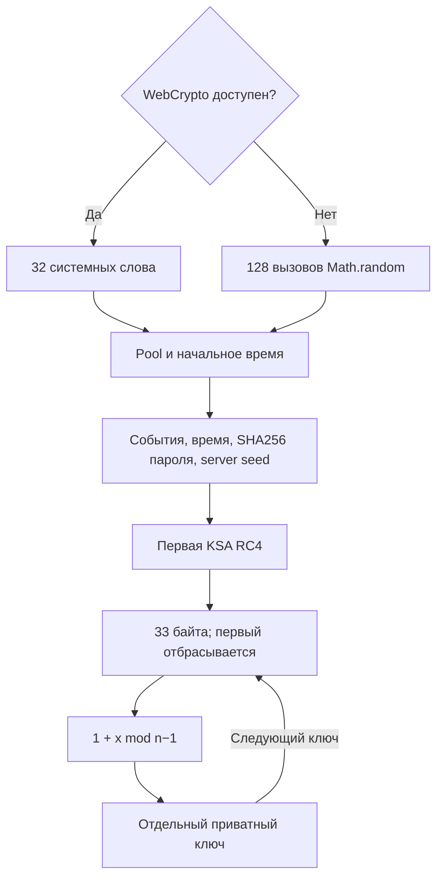

> English machine translation of the [Russian source](<../../../../ru/reports/experiments/randstorm-my-wallet-20261102/README.md>). Formulae, identifiers and source data are retained. Consult the source if wording is ambiguous.

> Documentary copy, 2026-11-25. [Beginning](<../../../README.md>) · [Direction](<../../../topics/03-wallets.md>) · [Documents of the series](<INDEX.md>)
> Historical plans are not a launch mission. The current outcome is [summary](<../../../docs/LATEST_RESULTS.md>).

# RND-01 Historical audit My Wallet

Result: [RESULTS.md](<RESULTS.md>)Protocol: [PROTOCOL.md](<PROTOCOL.md>)Interim conclusions: [JOURNAL.md](<JOURNAL.md>)Numbers: [NUMERIC_REPORT.md](<NUMERIC_REPORT.md>).

Officially investigated Blockchain.info My Wallet29.12.2013, commit031863d30590754f5d02fc10488236b1dc30f7f7. Neighbouring pictures2012/2015 It's just for distinguishing between branches CPU, Synthetic parameters; real search puzzle/wallets and GPU They didn't start.

After the first KSA staffing pool don't restart live RC4. No BIP32-master in this way, masking puzzle The wallet itself is not implemented; it is an external research hypothesis.

## Teams

PowerShell root btc test. Use of existing Python3.11 venv s coincurve local Node24.18.0; none npm-packet/No new dependencies have been established.

> Executable code/The commands are omitted in the documentary copy.

`check.py` at the finished result checks the code/data/artifacts and never repeat JS/EC. The changed input requires a new folder of the experiment. `report.py` numerical table NATIVE/CHECKS, non-interpretation RESULTS and a magazine. `seal.py verify` Checks all accepted files.

In the new folder, you can repeat the preparation: `fetch.py` → `prepare.py` → `check.py` → `acceptance.py` → `report.py`Additional files V8/failed Chromium-path load `supplemental_fetch.py`In the accepted folder, do not re-collect or overwrite the results - use cache/verify.

## Artifacts and Limits of Reproduction

- `URLS.json`, `SOURCES.json`, `sources/`: URL/UTC/SHA256 Every download, the errors are saved. `PROVENANCE.json`:23 Git blob SHA1 and pins borrowed E12 model/affine. Imported functions are copied, the original E12 It doesn't change.
- `prepare.py`: extracts precise _seed/generateNewKey historical wallet.js. `probe.cjs`: Completely complete historical BitcoinJS bundle; VM synthetically Date/Math/WebCrypto and stubs DOM/save. No service Blockchain.info He's not called.
- `CASES.json`:24 script. `NATIVE.json`:all words Math.random, dates, WebCrypto-challenges, initial pool/KSA,33Byte queries, keys and two address formats. `NODE_RUN.json`: stdout/stderr/returncode.
- `check.py`: independent Python pool/RC4, V8 arithmetic, coincurve/affine; `CHECKS.json`: control statements and versions07.01.2015 separately inspected RC4 and EC-results, but not complete pool.
- `bootstrap-control.cjs`, `BOOTSTRAP_*.json`:106 independent Python/JS BigInt examples48-bit-initialization V8. This is a transcription of functions, not the launch of a binary of a historical browser.
- `ACCEPTANCE.json`: no-work resume, preservation E12. `COMPLETE.json`: the final hashes of all files.

Not installed: browser/author's program, real values of entropy, historical DOM/server-Configuration and early achievability RC4 full-time _seed and method of recovery by masked puzzle-No percentage of the probability of a model from these controls follows.
