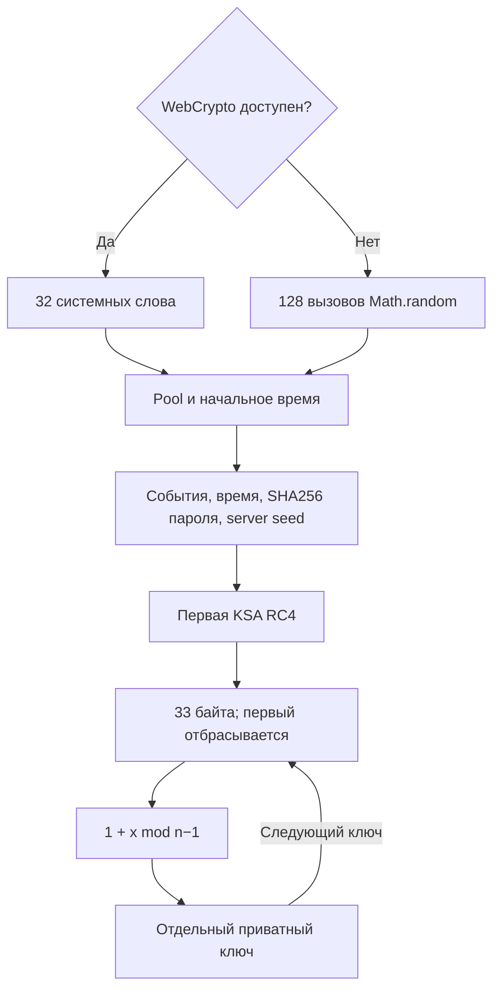

> [English](<../../../../en/reports/experiments/randstorm-my-wallet-20261102/README.md>) · [Выбор языка](<../../../../README.md>)

> Документационная копия, 2026-11-25. [Начало](<../../../README.md>) · [Направление](<../../../topics/03-wallets.md>) · [Документы серии](<INDEX.md>)
> Исторические планы не являются заданием на запуск. Текущий итог — в [сводке](<../../../docs/LATEST_RESULTS.md>).

# RND-01 — аудит исторического My Wallet

Результат: [RESULTS.md](<RESULTS.md>). Протокол: [PROTOCOL.md](<PROTOCOL.md>). Промежуточные выводы: [JOURNAL.md](<JOURNAL.md>). Числа: [NUMERIC_REPORT.md](<NUMERIC_REPORT.md>).

Исследуется официальный Blockchain.info My Wallet29.12.2013, commit031863d30590754f5d02fc10488236b1dc30f7f7. Соседние снимки2012/2015 нужны только для различения веток. Расчёты CPU, синтетические параметры; настоящий поиск puzzle/кошельков и GPU не запускались.

После первой KSA штатные подмешивания в pool не перезапускают живой RC4. Нет BIP32-master в этом пути. Маскирование puzzle в самом кошельке не реализовано; это внешняя исследовательская гипотеза.

## Команды

PowerShell из корня btc test. Используется существующий Python3.11 venv с coincurve и локальный Node24.18.0; никаких npm-пакетов/новых зависимостей не установлено.

> Исполняемый код/команды опущены в документационной копии.

`check.py` при готовом результате проверяет код/данные/артефакты и не повторяет JS/EC. Изменившийся вход требует новой папки эксперимента. `report.py` строит числовые таблицы из NATIVE/CHECKS, не трогая интерпретации RESULTS и журнал. `seal.py verify` проверяет все принятые файлы.

В новой папке можно повторить подготовку: `fetch.py` → `prepare.py` → `check.py` → `acceptance.py` → `report.py`. Дополнительные файлы V8/неудачный Chromium-path загружает `supplemental_fetch.py`, имеющий отдельный манифест. В принятой папке повторно не собирать и не перезаписывать результаты — пользоваться cache/verify.

## Артефакты и пределы воспроизведения

- `URLS.json`, `SOURCES.json`, `sources/`: URL/UTC/SHA256 каждой загрузки, ошибки сохранены. `PROVENANCE.json`:23 Git blob SHA1 и pins заимствованных из E12 model/affine. Импортированные функции копируются, исходный E12 не меняется.
- `prepare.py`: извлекает точные _seed/generateNewKey из исторического wallet.js. `probe.cjs`: выполняет полный исторический BitcoinJS bundle; VM предоставляет синтетические Date/Math/WebCrypto и заглушки DOM/save. Никакого сервиса Blockchain.info не вызывается.
- `CASES.json`:24 сценария. `NATIVE.json`: все слова Math.random, даты, WebCrypto-вызовы, initial pool/KSA,33байтные запросы, ключи и два формата адреса. `NODE_RUN.json`: stdout/stderr/returncode.
- `check.py`: независимые Python pool/RC4, V8 arithmetic, coincurve/affine; `CHECKS.json`: контрольные утверждения и версии. Для07.01.2015 отдельно проверены RC4 и EC-результаты, но не полный pool.
- `bootstrap-control.cjs`, `BOOTSTRAP_*.json`:106 независимых Python/JS BigInt примеров48-битной инициализации V8. Это транскрипция функций, не запуск бинарника исторического браузера.
- `ACCEPTANCE.json`: no-work resume, сохранность старого E12. `COMPLETE.json`: финальные хэши всех файлов.

Не установлены: браузер/программа автора, реальные значения энтропии, историческая DOM/server-конфигурация, достижимость раннего RC4 до штатного _seed и способ восстановления по маскированным puzzle-решениям. Никакой процент вероятности модели из этих контролей не следует.
